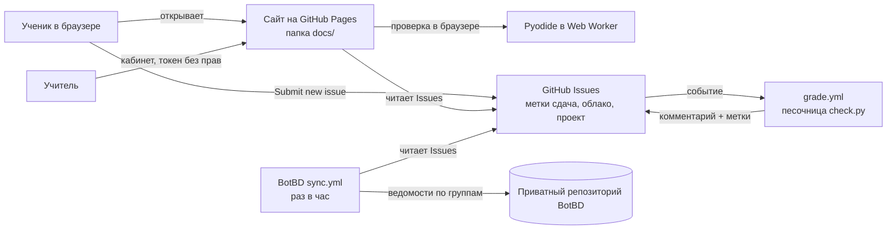
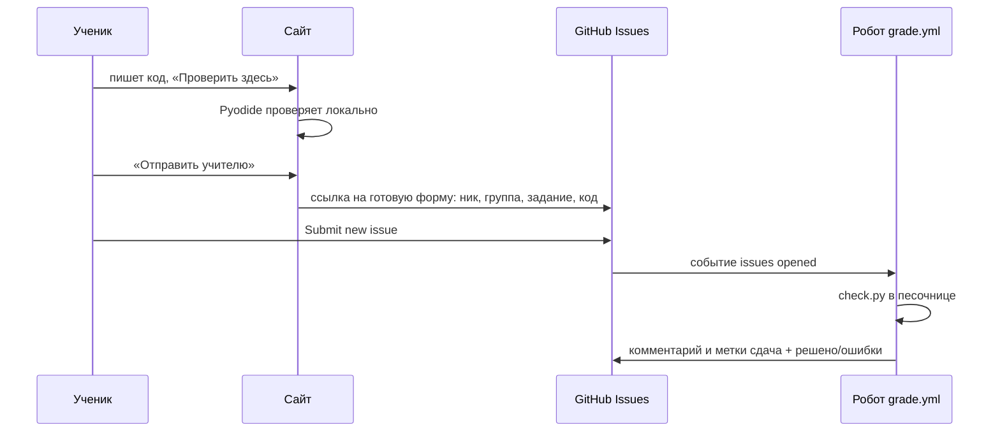

# 2. Архитектура

## Общая схема

Сайт статический. Серверов, баз данных и паролей нет. «Базой» служат GitHub Issues, а «серверной логикой» GitHub Actions.

## Путь одной сдачи

## Структура репозитория

| Путь | Что внутри |
|---|---|
| `docs/` | Сайт целиком (публикуется на GitHub Pages) |
| `docs/data/` | `tasks.js` (генерируется), `theory.js` (теория) |
| `docs/questions.js` | 41 вопрос квизов |
| `docs/runner/` | Браузерная проверка: `worker.js`, `check.js` |
| `docs/pyodide/` | Python в браузере (Pyodide 314.0.7), лежит у нас, без CDN |
| `docs/fonts/` | Press Start 2P и IBM Plex Mono |
| `docs/decks/` | Презентации: `city.js` (слайды), `traces.js` (генерируется) |
| `lessons/lessonN/task_*/` | Задание: `task.json`, `README.md`, заготовка `.py` |
| `check.py` | Проверяющий скрипт и песочница |
| `tools/` | `build_site.py`, `make_traces.py`, `template_task/` |
| `tests/` | `test_sandbox.py`, `browser_tests.py` |
| `.github/workflows/` | `pages.yml`, `grade.yml`, `check.yml`, `tests.yml` |
| `.github/ISSUE_TEMPLATE/` | `submit.yml` (генерируется), `project.yml`, `cloud.yml` |
| `projects/` | Проекты, добавленные Pull Request |
| `documentation/` | Эта документация |

## Автоматизация (GitHub Actions)

| Workflow | Когда | Что делает |
|---|---|---|
| **Сайт** `pages.yml` | push в `main`, вручную | Запускает `tools/build_site.py`, публикует `docs/` |
| **Проверка сдачи** `grade.yml` | Issue создан или изменён | Для заголовка `[Сдача]` проверяет код и отвечает; для `[Проект]` и `[Облако]` ставит метку |
| **Автопроверка** `check.yml` | push, Pull Request | Запускает `python check.py` по всем заданиям и пишет таблицу результатов на вкладке Actions (удобно тем, кто решает в своём форке) |
| **Тесты** `tests.yml` | push, Pull Request | Тесты песочницы и браузерные тесты (smoke, functional, teacher, slides) |

Метки ставит робот, а не форма: ученик не может сам пометить заявку как `решено` или `облако`.

## Что генерируется, а что пишется руками

| Генерируется (не править) | Источник | Команда |
|---|---|---|
| `docs/data/tasks.js` | `lessons/**/task.json` | `python3 tools/build_site.py` |
| `.github/ISSUE_TEMPLATE/submit.yml` | то же | то же |
| Таблица в `README.md` | то же | то же |
| `docs/decks/traces.js` | `tools/make_traces.py` | `python3 tools/make_traces.py` |

## Дизайн-система (Windows 95)

Токены лежат в `:root` файла `docs/site.css`.

| Токен | Значение | Роль |
|---|---|---|
| `--desk` | `#2f7777` | Бирюзовый рабочий стол |
| `--title` | `#3a1aa0` | Синяя полоса заголовка окна |
| `--cream` | `#fffbdc` | Кремовые кнопки и слайды |
| `--paper` | `#e8e8e8` | Серое «тело» окна |
| `--hard` | `4px 4px 0 #000` | Жёсткая тень без размытия |
| `--px` | Press Start 2P | Заголовки и кнопки |
| `--mono` | IBM Plex Mono | Основной текст и код |

Пиксельные иконки рисуются из карт символов 16×16 (`PIX` в `site.js`, дополнительные в `slides.js`).

## Ключевые решения

| Решение | Почему |
|---|---|
| Issues как база данных | Бесплатно, у учеников уже есть аккаунт, история и модерация встроены |
| Pyodide лежит в репозитории | Работает без внешних сайтов и в школьной сети |
| Проверка в браузере и на сервере | В браузере быстро и без аккаунта; на сервере результат фиксируется для учителя |
| ФИО не в публичной форме | Дети; Issues читают все |
| Репозиторий публичный | На бесплатном плане Pages из приватного репозитория не работает, а ученики не смогли бы создавать Issues |
