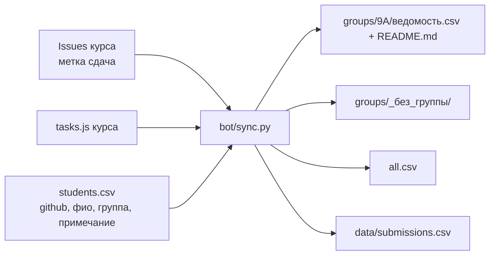

# 5. Кабинет учителя и робот BotBD

## Кабинет учителя (`teacher.html`)

Вход: меню «Пуск» → «Вход для учителя» (или адрес `teacher.html`) → токен GitHub **без прав** (инструкция на странице). Сайт спрашивает у GitHub `GET /user` и пускает, только если логин равен владельцу репозитория (`VMSE1`). Токен нужен лишь для этой проверки и для увеличения лимита запросов.

| Вкладка | Что делает |
|---|---|
| Сводка | Таблица «ученик, задания, решено, ошибки, активность, лучший процент за тест»; кнопки «Скачать ведомость (Excel)» и «Печать» |
| Ученики | Ник, GitHub-логин, группа, ФИО (вписываешь сам); кнопки «Сохранить», «Выгрузить файл» и экспорт `students.csv` для робота |
| Тест | Вставляешь коды результатов квизов, нажимаешь «Разобрать» |

Где что хранится:

- Соответствие «ник → ФИО» только в `localStorage` твоего браузера. Не забудь «Выгрузить файл» как копию.
- Выгрузка собирается в браузере и никуда не отправляется.
- Токен: `sessionStorage` (стирается при закрытии вкладки) или 7 дней, если отмечено «запомнить».

## Робот BotBD

Отдельный репозиторий `VMSE1/BotBD`. Он хранит выгрузку и раскладывает её по группам. **Репозиторий обязан быть приватным.**

### Что делает

1. Каждый час (`cron 7 * * * *`) или вручную (Actions → «Обновить ведомость» → Run workflow).
2. Читает Issues курса с меткой `сдача` и список заданий.
3. Считает по каждому GitHub-логину: сколько заданий решено, сколько ошибочных попыток, когда последняя активность.
4. Сводит с `students.csv`: берёт ФИО и группу. Новые логины добавляются в файл автоматически, существующие строки не перезаписываются. Группа из `students.csv` важнее той, что написал ученик.
5. Пишет ведомости: `groups/<группа>/ведомость.csv` и `README.md`, `groups/_без_группы/`, общий `all.csv`, подробный `data/submissions.csv`, `README.md` с итогами.

### Группы

- Ученик пишет группу в форме. Значения «нет», «0», «-» и пустое попадают в `_без_группы`.
- Название группы приводится к виду `0-9 A-Z А-Я Ё _ -`, не длиннее 20 знаков. Это защита от путей вида `../`.

### Безопасность

- Если репозиторий публичный, робот **не записывает данные** и завершается с ошибкой (`GET /repos/$GITHUB_REPOSITORY` должен вернуть `private: true`).
- Значения в CSV и Markdown экранируются, чтобы ячейка не превращалась в формулу или разметку.
- Используются только стандартная библиотека Python и `GITHUB_TOKEN` самого workflow.

### Первый запуск

1. BotBD: Settings → General → Danger Zone → Change visibility → **Private**.
2. Actions → «Обновить ведомость» → Run workflow.
3. В кабинете курса: вкладка «Ученики» → экспорт `students.csv` → допиши ФИО → загрузи файл в BotBD (заменив пустой).
4. Через час (или снова вручную) ведомости по группам обновятся.

### Тесты

`python3 -m unittest bot.test_sync` в репозитории BotBD (11 тестов). Они запускаются в workflow перед каждой синхронизацией.
