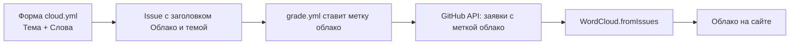

# 6. Облако слов

Ученики пишут слова по теме, облако на сайте показывает самые частые крупнее. Хранилище: GitHub Issues.

## Как это работает для ученика

1. Открыть «Облако слов» (рабочий стол или «Пуск»).
2. Выбрать тему (или «+ Новая тема…» и назвать её).
3. Написать до 5 слов через запятую, нажать «Добавить в облако».
4. На GitHub открывается готовая заявка: нажать **Submit new issue**.
5. Вернуться на сайт, нажать «Обновить»: слова на месте.

Ссылка на конкретную тему: `cloud.html?t=Что%20такое%20Python`. Если такой темы ещё нет, страница предложит её создать.

## Как устроено хранилище

- Шаблон формы: `.github/ISSUE_TEMPLATE/cloud.yml` (поля «Тема», «Слова»).
- Метку `облако` ставит робот (`label-cloud` в `grade.yml`) по заголовку, который начинается с `[Облако]`.
- Страница читает заявки через `fetchIssues("облако", …)` (до 500 штук, по 100 на страницу).

## Правила подсчёта

| Правило | Зачем |
|---|---|
| Слово приводится к нижнему регистру, лишние знаки убираются, длина до 24 | Чтобы «Python», «python!» и «PYTHON» были одним словом |
| До 5 слов из одной заявки | Против заливки |
| Один человек даёт слову один голос (по GitHub-логину) | Против накрутки: одно слово от одного человека считается один раз, сколько бы заявок он ни создал |
| Тема сравнивается без регистра и знаков | «Что такое Python» и «что такое python!» это одна тема |
| Заявка с меткой `скрыто` игнорируется | Модерация |

## Модерация (учитель)

1. Открыть заявку с лишним словом в Issues.
2. Поставить метку `скрыто` (если метки нет, создай её: Issues → Labels → New label).
3. Нажать «Обновить» на странице облака: слова исчезнут.

Чтобы убрать тему целиком, поставь `скрыто` всем её заявкам или закрой их массово и убери метку `облако`.

## Программный интерфейс (`docs/cloud.js`)

| Функция | Что делает |
|---|---|
| `WordCloud.render(элемент, слова, {width, height, max})` | Рисует облако SVG. Слова: строки или `{text, count}` |
| `WordCloud.topics(issues)` | Темы из заявок: `[{name, key, n}]` |
| `WordCloud.fromIssues(issues, key)` | Слова темы `[{text, count}]`, `count` = число разных людей; свойство `people` у массива |
| `WordCloud.parse(issues)` | Разбор заявок: `[{name, key, who, words}]` |
| `WordCloud.clean(text)`, `WordCloud.topicKey(text)` | Нормализация слова и темы |

Слова выводятся через `textContent`, поэтому HTML внутри слов не исполняется.

## Ограничения

- Облако обновляется по кнопке, а не само: у GitHub API без токена лимит 60 запросов в час на IP.
- Данные публичные: слова и GitHub-логины авторов видны в Issues.
- Расположение слов простое (спираль). Для сотен разных слов облако показывает самые частые (до 60).
