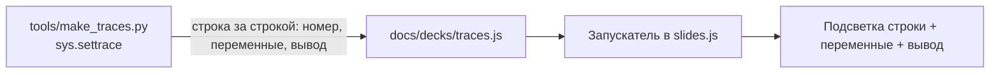

# 7. Презентации

Страница `slides.html` показывает презентацию как окно Windows 95. Сейчас в ней одна колода: «Городской помощник» (23 слайда). Она пересобрана из `.pptx` исходной презентации: тексты и примеры кода те же, оформление и интерактив новые.

## Управление

| Действие | Как |
|---|---|
| Дальше | → , Пробел, PageDown или кнопка «Дальше» |
| Назад | ← , PageUp |
| Первый и последний слайд | Home, End |
| Во весь экран | F или кнопка «Во весь экран» |
| Оглавление | Кнопка «Слайды» |
| На телефоне | Свайп влево и вправо |

Ссылка на слайд: `slides.html#12`. На слайдах с пунктами каждое нажатие «Дальше» показывает следующий пункт.

## Интерактив

| Слайд | Что можно делать |
|---|---|
| 1 | Печатается и выполняется `print("Привет, мир!")` |
| 2 | Нажать на карточку: подробности |
| 3 | Пункты появляются по одному, внизу печатается код |
| 6 | Цикл разработки: нажать этап или «Показать цикл» |
| 7 | Алгоритм «чай»: выполнить, перепутать шаги и увидеть ошибку |
| 8, 10, 12, 14, 15, 19 | **Запуск кода по шагам**: подсвеченная строка, переменные, вывод |
| 9 | Калькулятор Python-выражений (приоритет операций, `//`, `%`, `**`) |
| 11 | Нажать на значение: тип; нажать на ошибку: пример и сообщение |
| 13 | Ползунок расстояния: подсвечиваются строки `if/elif/else` и точка на числовой прямой |
| 15 | Нажать на элемент списка; `append` добавляет четвёртый |
| 16 | Схема программы: пройти путь для Анны, Ильи, Марии |
| 17 | Мини-игра «угадай вывод» на границах 2, 2.1, 8, 8.1 |
| 20 | Живая консоль «Городского помощника»: ввод имени и расстояния, три сценария, ошибка `ValueError` при вводе «abc» |
| 21 | Чек-лист практики с прогрессом |
| 22 | Ссылки на задания 2.4, 3.4, 5.4 и теорию |
| 23 | Итоги и ссылка в облако слов |

## Как работает запуск кода

Запуск не «нарисован»: примеры выполняются настоящим Python при сборке, а страница проигрывает запись.



- В `make_traces.py` описаны примеры (`SNIPPETS`) с кодом и вводом. Скрипт выполняет каждый пример и записывает шаги.
- Если поменять код примера, нужно перегенерировать: `python3 tools/make_traces.py`.
- «Запустить» проигрывает шаги автоматически, «Шаг» делает один шаг, «Сначала» сбрасывает.
- Сложные слайды (калькулятор, консоль) работают на JavaScript и повторяют логику Python.

## Как добавить слайд или презентацию

Колода это файл `docs/decks/<имя>.js`, который задаёт `window.DECK = {title, slides}`.

```js
S.push({
  t: "Заголовок слайда",      // в полосе заголовка
  ic: "book",                 // иконка: pc folder book disk key help doc check win bulb cup globe bug chart gear game team
  html: '<p>Текст</p>' + DeckKit.runner("print", "hello.py"),
  init: function (sec) { /* по желанию: оживить элементы внутри sec */ }
});
```

- `class="frag"` на элементе: он появится по нажатию «Дальше».
- `DeckKit.runner("id", "имя.py")`: окно с кодом; `id` берётся из `traces.js`.
- `DeckKit.card(иконка, заголовок, текст, класс)`: карточка.
- `DeckKit.numline(id)` и `DeckKit.setMark(id, км)`: числовая прямая.
- Новый пример для запускателя: добавь в `SNIPPETS` в `tools/make_traces.py` и перегенерируй.
- Чтобы показать другую колоду, подключи её файл в `slides.html` вместо `decks/city.js`.

## Что не вошло из исходного pptx

- Слайд 7 был картинкой без текста.
- Слайд 23 предлагал запустить игру на pygame и `demo.html`. Файлов в репозитории нет, поэтому вместо него слайд «Что дальше» со ссылками на задания.
- Фотографии и иллюстрации заменены пиксельными иконками в стиле сайта.

## Печать

В печатной версии (Ctrl+P) каждый слайд идёт на отдельной странице, пункты показываются сразу.
